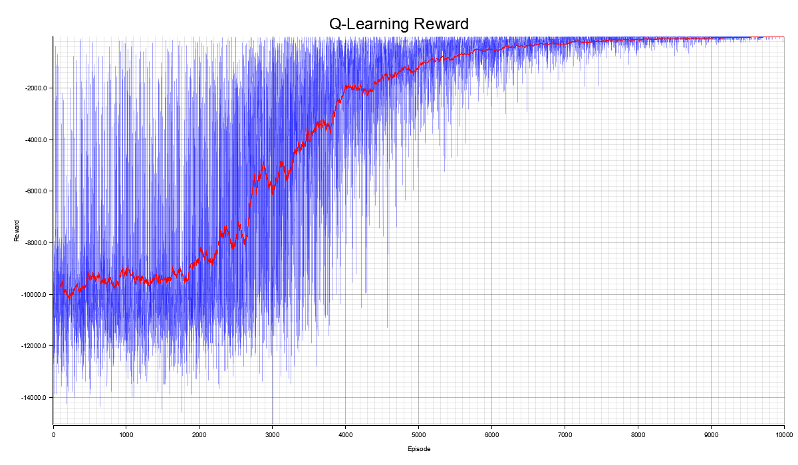

# Gridworld

## Build & Run

```bash
cargo run
```

## Environment

Cliff Walking

- `4 x 12` 크기의 격자
- 시작점: 왼쪽 아래 `(x: 0, y: 3)`
- 목표점: 오른쪽 아래 `(x: 11, y: 3)`
- 절벽(Cliff): 시작점과 목표점을 제외한 아래쪽 행으로 절벽 칸에 들어가면 시작점으로 복귀

## Reward

- 매 이동마다 `-1`
- 절벽으로 이동 시 `-100`

## Algorithms

### Q-Learning

$$Q(s,a) \leftarrow Q(s,a) + \alpha \left[r + \gamma \max_{a'} Q(s',a') - Q(s,a)\right]$$

- State($s$): 현재 상태
- Action($a$): 선택한 행동
- Reward($r$): 행동에 따른 보상
- Alpha($\alpha$): 학습률
- Gamma($\gamma$):
- $Q(s, a)$: 상태 $s$에서 행동 $a$의 value



- `10000` episodes, `1000` steps
- $\gamma$: 1.0
- $\alpha$: 0.1
